# NovaWealth Voice Agent: Bilingual Investor-Support Voice AI (RAG + MCP)

A hands-free voice assistant for a fictional investment company, **NovaWealth**. Open the page,
press **Start call** and just talk, in **English or Hindi**. Nova detects real speech (ignoring
background noise), works out what you need, and answers out loud. Behind each answer, an LLM
decides whether to search the company knowledge base (**RAG**), call live tools on a separate
**MCP server** (market hours, SIP projections, date math, calculator), or both. It stays
strictly on investment topics and never gives personal buy/sell advice.

```
Nova: Hello, welcome to NovaWealth. Would you like to talk in English or Hindi? नमस्ते, ...
You:  Hindi
Nova: ठीक है, हम हिंदी में बात करेंगे। बताइए, मैं आपके निवेश से जुड़ी किस बात में मदद कर सकती हूँ?
You:  अगर मैं हर महीने 10,000 रुपये की SIP 10 साल तक करूँ और 12% रिटर्न मानें तो कितना बनेगा?
      [ROUTER] LLM chose tool(s): investment_projection
Nova: 10 साल में हर महीने ₹10,000 की SIP, 12% के माने गए रिटर्न पर लगभग ₹23.23 लाख बनती है।
      कुल निवेश ₹12 लाख होगा। यह सिर्फ एक उदाहरण है, रिटर्न गारंटीड नहीं हैं।
You:  Who won the cricket match yesterday?
Nova: I can only help with NovaWealth and investment questions, ...
```

> NovaWealth, its funds and all figures are fictional, created for this demo.

## Contents

- [Features](#features)
- [High-level design](#high-level-design)
- [Architecture](#architecture)
- [Design decisions and trade-offs](#design-decisions-and-trade-offs)
- [Setup](#setup)
- [Running](#running)
- [Deploying to AWS](#deploying-to-aws)
- [Environment variables](#environment-variables)
- [Example queries](#example-queries)
- [Tests](#tests)
- [Project structure](#project-structure)
- [Troubleshooting](#troubleshooting)
- [Future improvements](#future-improvements)

## Features

- **Hands-free, full-duplex calls in the browser.** Silero VAD (a neural voice-activity model,
  running in the page) detects *human speech* and ignores fans, typing, knocks and music.
  There are no buttons to press while talking, and you can interrupt Nova mid-sentence (barge-in).
- **English or Hindi.** Every call opens by asking which language you want; the reply language,
  speech-recognition model and voice all follow your choice. Hindi hang-up phrases work too.
- **The LLM does the routing.** Each turn the model sees every tool and picks RAG, MCP or both,
  in parallel when possible.
- **RAG as a tool**: `search_knowledge_base(query, top_k)` over 6 NovaWealth documents
  (funds, SIPs and redemptions, KYC, fees, risk and compliance, company info).
- **MCP server** (FastMCP, stdio): `get_current_time`, `get_market_status`,
  `investment_projection`, `calculate`, `days_between`, `read_system_log`. Schemas are
  discovered at runtime, never duplicated by hand.
- **Scope and compliance guard-rails.** Off-topic questions are politely declined; no stock tips,
  no "which fund should I buy", no promised returns; projections carry a disclaimer.
- **Grounded by construction.** The first step of every turn *must* call a tool, so answers come
  from the knowledge base or a tool result, not the model's memory (see trade-offs).
- **Resilient.** If the main LLM hits a Groq rate limit, the agent switches automatically to a
  fallback model. Tool errors go back to the LLM, looping answers are cut, and calls never crash.
- **Side-panel transcript** of everything said on the call, with cited sources.
- Terminal mode too (`python main.py`): push-to-talk, or `--text` for typing.
- **137 offline tests.**

## High-level design

> Source: [`docs/hld.mmd`](docs/hld.mmd) · Exported image: [`docs/hld.png`](docs/hld.png)

```mermaid
flowchart LR
    classDef io fill:#e3f2fd,stroke:#1565c0,color:#0d47a1
    classDef voice fill:#ede7f6,stroke:#5e35b1,color:#311b92
    classDef brain fill:#fff3e0,stroke:#ef6c00,color:#e65100
    classDef rag fill:#e8f5e9,stroke:#2e7d32,color:#1b5e20
    classDef mcp fill:#e0f7fa,stroke:#00838f,color:#006064
    classDef ext fill:#fafafa,stroke:#757575,color:#424242,stroke-dasharray:4 3
    classDef store fill:#f1f8e9,stroke:#558b2f,color:#33691e

    USER(["Caller<br/>English or Hindi"]):::io

    subgraph CLIENTS["Caller interfaces"]
        direction TB
        WEB["Browser call UI (web/)<br/>Silero VAD in-browser: speech only,<br/>noise ignored, full duplex + barge-in<br/>side-panel transcript"]:::voice
        CLI["Terminal (main.py)<br/>sounddevice push-to-talk<br/>or fixed duration"]:::voice
    end

    STT["STT: Groq Whisper<br/>auto-detect until language chosen,<br/>then en (turbo) / hi (large-v3)<br/>+ hallucination filter"]:::voice

    subgraph AGENT["Agent process (agent/)"]
        direction TB
        CALL["CallSession<br/>asks English or Hindi, locks language<br/>(prompt + STT + voice), hang-up,<br/>spoken apologies on errors"]:::brain
        ORCH["Orchestrator<br/>tool loop (max 5), tool required on step 1<br/>session memory, compacted tool results<br/>tool errors returned to LLM"]:::brain
        LLM{{"LLM router (Groq)<br/>qwen/qwen3.8-27b<br/>auto-fallback: gpt-oss-120b<br/>scope + compliance prompt"}}:::brain
        REG["Tool registry<br/>local + MCP tools<br/>(schemas discovered at runtime)"]:::brain
        CALL -->|"utterance"| ORCH
        ORCH <-->|"messages + tool schemas /<br/>tool calls or final answer"| LLM
        ORCH -->|"dispatch tool calls"| REG
    end

    subgraph RAG["RAG knowledge layer: in-process tool (rag/)"]
        direction TB
        KBT["search_knowledge_base<br/>(English query, top_k)"]:::rag
        EMB["all-MiniLM-L6-v2<br/>(local embeddings)"]:::rag
        CHROMA[("ChromaDB<br/>storage/chroma")]:::store
        CHUNKS["Top-k chunks<br/>+ source and section"]:::rag
        KBT --> EMB -->|"query vector"| CHROMA --> CHUNKS
    end

    subgraph MCPSYS["MCP: system tools (separate process, stdio)"]
        direction TB
        MCPC["MCPClient<br/>list_tools / call_tool"]:::mcp
        MCPS["FastMCP server<br/>mcp_server/server.py"]:::mcp
        T1["get_current_time"]:::mcp
        T2["get_market_status<br/>(NSE/BSE hours)"]:::mcp
        T3["investment_projection<br/>(SIP / lump sum, lakh-crore)"]:::mcp
        T4["calculate<br/>(AST whitelist)"]:::mcp
        T5["days_between<br/>(lock-in periods)"]:::mcp
        T6["read_system_log"]:::mcp
        MCPC <-->|"JSON-RPC over stdio"| MCPS
        MCPS --- T1 & T2 & T3 & T4 & T5 & T6
    end

    TTS["TTS: edge-tts<br/>en-IN Neerja / hi-IN Swara<br/>parallel sentence synthesis"]:::voice

    subgraph INGEST["Offline ingestion: python -m rag.ingest [--rebuild]"]
        direction LR
        DOCS["data/docs/*.md<br/>6 NovaWealth docs"]:::store
        CHUNKER["Heading-aware chunker<br/>~550 chars, ~80 overlap"]:::rag
        EMB2["MiniLM embeddings"]:::rag
        UPSERT["Idempotent upsert<br/>stale docs removed"]:::rag
        DOCS --> CHUNKER --> EMB2 --> UPSERT
    end

    USER -->|"speaks"| WEB & CLI
    WEB -->|"WAV utterance"| STT
    CLI -->|"WAV"| STT
    STT -->|"transcript"| CALL
    REG -->|"local tool"| KBT
    CHUNKS -->|"tool result"| ORCH
    REG -->|"MCP tool"| MCPC
    MCPC -->|"tool result"| ORCH
    ORCH -->|"answer + trace"| CALL
    CALL -->|"reply in call language"| TTS
    TTS -->|"MP3"| WEB & CLI
    WEB -->|"hears answer"| USER
    UPSERT ==>|"writes"| CHROMA

    style CLIENTS fill:#f8f7fc,stroke:#b39ddb
    style AGENT fill:#fffaf3,stroke:#ffb74d
    style RAG fill:#f6fbf6,stroke:#81c784
    style MCPSYS fill:#f3fbfc,stroke:#4dd0e1
    style INGEST fill:#f9fbf5,stroke:#aed581
```




## Architecture

### Components

| Layer | Module | Responsibility |
|---|---|---|
| Browser call UI | `web/static/index.html` | Silero VAD speech detection, full-duplex barge-in, WAV encoding, playback, animated status orb, transcript side panel. No build step. |
| Web server | `web/app.py` | FastAPI: `/api/call`, `/api/turn`, `/api/end`. One `CallSession` per call; shares the MCP server and models across calls. |
| Terminal loop | `main.py` | Same call flow from the terminal: push-to-talk or fixed-duration recording, or typed input. |
| Call flow | `agent/call.py` | `CallSession`: asks for and locks the language, hang-up detection, turns failures into spoken apologies in the caller's language. |
| Languages | `agent/language.py` | English/Hindi detection from the caller's answer, per-language phrases and prompt rules. |
| Orchestrator | `agent/orchestrator.py` | Tool-calling loop, tool registry (local + MCP), parallel execution, required first tool call, iteration cap, memory compaction, sources. |
| LLM client | `agent/llm_client.py` | `LLMClient` protocol + Groq implementation: rate-limit fallback model, reasoning stripping, repetition guard. |
| MCP client | `agent/mcp_client.py` | Spawns the MCP server over stdio, converts its tool schemas to function-calling format. |
| Prompt | `agent/prompts.py` | Scope, compliance, grounding and spoken-style rules; hang-up phrases. |
| RAG | `rag/` | Heading-aware chunking + idempotent ingest (removes stale docs), MiniLM + Chroma retrieval, the `search_knowledge_base` tool. |
| MCP server | `mcp_server/server.py` | FastMCP tools; finance math in `finance.py`, safe calculator in `calculator.py`. |
| Voice | `voice/` | Groq Whisper STT (per-language model, hallucination filter), edge-tts (per-language voice, parallel synthesis), terminal recorder. |

### One turn in the browser

1. **Detect speech.** Every 32 ms the page gets Silero's speech probability. An utterance
   starts after ~100 ms of frames that are both speech-like (p ≥ 0.6) and louder than the
   learned room noise, and ends after 700 ms of non-speech. Bursts under 300 ms are dropped,
   and 400 ms of audio from before the start is kept so first syllables aren't clipped.
2. **Barge-in.** While Nova talks the mic stays live. Interrupting needs high confidence
   (p ≥ 0.85) and a clearly louder voice for ~190 ms, so Nova's own voice leaking from the
   speakers (already reduced by browser echo cancellation) doesn't cut her off.
3. **Transcribe.** The utterance goes to `/api/turn` as 16 kHz WAV. Whisper runs with no language
   until the caller picks one, then `en` (turbo) or `hi` (large-v3). Stock Whisper
   hallucinations on noise ("Thank you.") are discarded silently.
4. **Route and act.** `CallSession` handles the language choice and hang-ups; everything else goes
   to the orchestrator, which loops LLM ↔ tools (max 5 steps; a tool call is required on step 1).
5. **Respond.** The answer is synthesized in the call language's voice (sentences in parallel),
   returned with the transcript and sources, shown in the side panel and played. The mic is
   already listening for the next question.

### Why RAG is a tool, not a pre-step

The LLM decides *what* to search for, rewriting a Hindi or rambling spoken question into a
focused English query that matches the English documents ("ELSS lock-in period"). It can search
again if the first results miss and combine retrieval with live tools in one step (lock-in rule
+ today's date + `days_between`). Small talk and pure calculations don't pay for retrieval.

### Why the knowledge base is local but system tools are on MCP

The knowledge base is the agent's own domain layer: same process, same model cache, no
serialization hop. Market status, projections, dates and the calculator are generic capabilities
that other agents or MCP clients (IDEs, desktop assistants) could reuse. Running them in a separate
process isolates failures. MCP over **stdio** needs no ports or auth, and the server's lifetime
is tied to the agent. The orchestrator treats both kinds of tool identically.

### Conversation memory

History is kept per call, but once a turn ends its raw tool results are replaced with a short
placeholder while the tool *calls* stay. Dropping the calls entirely made the model imitate
tool-free answers and invent facts; keeping full results wasted tokens and invited stale data
(yesterday's date, an earlier search).

## Design decisions and trade-offs

| Decision | Chosen | Why / trade-off |
|---|---|---|
| **Speech detection** | Silero VAD in the browser (ONNX), with an energy-based fallback | Energy thresholds can't tell a voice from a fan or music; Silero scores *speech*. Running it client-side means only real utterances are uploaded. Trade-off: about 2 MB of model and WASM from a CDN on first load; if that fails, the page falls back to the energy detector. |
| **Turn-taking** | Full duplex with barge-in | Feels like a real call. A stricter barge-in threshold guards against echo; headphones make it best. |
| **Grounding** | `tool_choice="required"` on each turn's first step | Prompt rules alone failed in Hindi: the model answered ELSS and SIP questions from memory. Forcing a tool call grounds every answer. Cost: off-topic or small-talk turns take one extra LLM call. Configurable via `REQUIRE_TOOL_FIRST`. |
| **LLM** | Groq `qwen/qwen3.8-27b` + `openai/gpt-oss-120b` fallback | Fast tool calling with parallel calls. Groq quotas are per model, and the free tier allows Qwen 200K tokens/day, so a second model keeps calls working when the first is exhausted. |
| **STT** | Whisper turbo (English, detection) / large-v3 (Hindi) | large-v3 was clearly more accurate on Hindi in testing; turbo is faster for English. |
| **TTS** | edge-tts `en-IN-NeerjaNeural` / `hi-IN-SwaraNeural` | Free, natural Indian voices, the same persona in both languages. Sentences are synthesized in parallel. |
| **Numbers** | Tools return lakh/crore strings; replies use digits | Spelling ₹12,00,000 out in Hindi words made the model loop ("एक लाख बीस हज़ार नहीं..."); digits are read naturally by the voices. A repetition guard truncates any looping answer. |
| **Scope** | Prompt-level domain restriction | Declines off-topic requests in one sentence and redirects. No separate classifier, which keeps latency low; a production system might add one. |
| **Embeddings / vector DB** | Local MiniLM + embedded Chroma | Free, offline, zero infrastructure. The LLM writes English queries, so English-only embeddings work for Hindi callers. |
| **MCP transport** | stdio | No deployment or auth; single local client. HTTP would allow a shared tool server. |

## Setup

**Prerequisites**

- **Python 3.11+** (developed and tested with 3.12 on macOS / Apple Silicon)
- A free **Groq API key**: https://console.groq.com/keys
- A microphone and speakers (headphones recommended for barge-in)
- Internet access (Groq, edge-tts, the VAD model CDN, and a one-time ~90 MB embedding download)
- **ffmpeg is not required.**

### macOS / Linux

```bash
git clone <your-repo-url> voice-agent && cd voice-agent

# Linux only, for the terminal mode's audio: sudo apt-get install -y libportaudio2

python3 -m venv .venv            # use python3.12 / python3.11 if python3 is older
source .venv/bin/activate
python -m pip install --upgrade pip
pip install -r requirements.txt

cp .env.example .env             # then set GROQ_API_KEY=gsk_...

python -m rag.ingest             # build the knowledge base
python -m web.app                # open http://127.0.0.1:8000 and press Start call
```

### Windows (PowerShell)

```powershell
git clone <your-repo-url> voice-agent; cd voice-agent

py -3.12 -m venv .venv
.\.venv\Scripts\Activate.ps1     # if blocked: Set-ExecutionPolicy -Scope CurrentUser RemoteSigned
python -m pip install --upgrade pip
pip install -r requirements.txt

Copy-Item .env.example .env      # then set GROQ_API_KEY=gsk_...

python -m rag.ingest
python -m web.app
```

The pinned `tzdata` package provides time zones on Windows.

## Running

| Command | What it does |
|---|---|
| `python -m web.app` | **Browser call** at http://127.0.0.1:8000: hands-free, bilingual, barge-in, transcript panel. |
| `python main.py` | Terminal voice call, push-to-talk (Enter to start and stop). Add `--duration 6` for fixed-length clips. |
| `python main.py --text` | Type instead of speaking; add `--tts` to hear answers, `--lang en` or `--lang hi` to skip the language question. |
| `python -m rag.ingest [--rebuild]` | (Re)build the knowledge base; mirrors `data/docs/` exactly. |
| `python -m mcp_server.server` | Run the MCP server standalone (e.g. with the MCP Inspector). |

End a call with **"goodbye"**, **"end call"**, **"अलविदा"** or **"कॉल खत्म"**, or press **End call**.

## Deploying to AWS

The app runs live on one small Ubuntu server (AWS Lightsail or EC2). A single script installs it,
runs it as a service, and serves it over **HTTPS** with Caddy; HTTPS is required for browser
microphone access. Step-by-step guide: [`deploy/README.md`](deploy/README.md).

```bash
# on the server
curl -fsSL https://raw.githubusercontent.com/molshreepandey/nova-ai-call/main/deploy/setup.sh -o setup.sh
sudo bash setup.sh
```

Set `ACCESS_CODE` (the script asks for it) when the URL is public, so only people with the code
can start calls and use your Groq quota.

## Environment variables

| Name | Required | Default | Description |
|---|---|---|---|
| `GROQ_API_KEY` | **yes** | – | Groq key for the LLM and Whisper. |
| `GROQ_MODEL` | no | `qwen/qwen3.8-27b` | Main tool-calling model. |
| `GROQ_FALLBACK_MODEL` | no | `openai/gpt-oss-120b` | Used automatically while the main model is rate-limited. Empty disables it. |
| `GROQ_REASONING_EFFORT` | no | *(empty)* | Passed to the main model; empty = model default. |
| `GROQ_STT_MODEL` | no | `whisper-large-v3-turbo` | Whisper for English and language detection. |
| `GROQ_STT_MODEL_HI` | no | `whisper-large-v3` | Whisper for Hindi calls. |
| `TTS_VOICE_EN` / `TTS_VOICE_HI` | no | `en-IN-NeerjaNeural` / `hi-IN-SwaraNeural` | edge-tts voices per language. |
| `EMBEDDING_MODEL` | no | `all-MiniLM-L6-v2` | Re-run ingest with `--rebuild` after changing it. |
| `REQUIRE_TOOL_FIRST` | no | `true` | Force a tool call before every answer (grounding). |
| `MAX_TOOL_ITERATIONS` | no | `5` | LLM↔tool round-trips per turn. |
| `MAX_HISTORY_TURNS` | no | `8` | Turns kept in memory. |
| `RAG_TOP_K` | no | `4` | Chunks per search. |
| `RECORD_SAMPLE_RATE` | no | `16000` | Terminal-mode recording rate. |
| `LOG_LEVEL` | no | `INFO` | `DEBUG` shows token usage per call. |
| `ACCESS_CODE` | no | *(empty)* | If set, the web page asks for this code before a call starts. |
| `HOST` / `PORT` | no | `127.0.0.1` / `8000` | Web server bind address. |

## Example queries

| Type | English | Hindi | Tools |
|---|---|---|---|
| RAG | "What is the exit load on the Flexi Cap fund?" | "ELSS फंड में लॉक-इन कितने साल का होता है?" | `search_knowledge_base` |
| RAG | "What documents do I need for KYC?" | "रिडेम्पशन का पैसा कितने दिन में आता है?" | `search_knowledge_base` |
| MCP | "Is the stock market open right now?" | "क्या अभी शेयर बाज़ार खुला है?" | `get_market_status` |
| MCP | "If I invest 10,000 a month for 10 years at 12%, what will I get?" | "हर महीने 10,000 की SIP 10 साल तक 12% पर कितनी बनेगी?" | `investment_projection` |
| **RAG + MCP** | "I invested in the ELSS fund on 1 March 2024. Can I redeem it today?" | – | `search_knowledge_base` + `get_current_time` → `days_between` |
| **RAG + MCP** | "What's the minimum SIP, and what would that grow to in 15 years at 12%?" | – | `search_knowledge_base` + `investment_projection` |
| Compliance | "Which fund should I buy to get rich fast?" | – | Neutral explanation, no recommendation, suggests an advisor |
| Scope | "What's the weather in Mumbai?" / "Who won the cricket match?" | – | Politely declined |

## Tests

```bash
python -m pytest -q          # 137 tests, about 1 s, no network or API key needed
```

Covers: the language state machine and detection (including Devanagari), hang-ups in both
languages, Whisper hallucination filtering, the orchestrator with a scripted LLM (RAG + MCP in
one turn, required first tool, failures, iteration cap, rollback, memory), the LLM rate-limit
fallback, the repetition guard, finance math against closed-form formulas, market hours,
lakh/crore formatting, calculator safety, RAG chunking and retrieval on a temporary Chroma, and
a real stdio MCP round-trip.

The browser pipeline was verified end to end in headless Chrome with a recorded fake
microphone: white noise, a beep, knocks and a music chord were ignored, while spoken requests
were detected, answered and correctly interrupted Nova (barge-in).

## Project structure

```
├── web/
│   ├── app.py               # FastAPI call server (python -m web.app)
│   └── static/index.html    # call UI: Silero VAD, barge-in, transcript panel
├── main.py                  # terminal call loop
├── config.py  display.py
├── agent/
│   ├── call.py              # CallSession: language, hang-up, apologies
│   ├── language.py          # English/Hindi detection + phrases
│   ├── orchestrator.py      # tool-calling loop, routing, memory
│   ├── llm_client.py        # Groq client, fallback model, guards
│   ├── mcp_client.py        # stdio MCP client + schema conversion
│   └── prompts.py           # scope / compliance / style rules
├── rag/                     # ingest.py, retriever.py, store.py, tool.py
├── mcp_server/              # server.py, finance.py, calculator.py
├── voice/                   # stt.py, tts.py, recorder.py
├── data/docs/               # 6 NovaWealth documents
├── deploy/                  # AWS setup script + guide
├── docs/hld.mmd, hld.png
└── tests/
```

## Troubleshooting

| Symptom | Fix |
|---|---|
| Stays on "Listening" and never hears you | Allow microphone access for the site (lock icon in the address bar). Check the browser is using the right input device in system sound settings. Speak at normal volume, close to the mic. |
| Nova interrupts herself | Her voice is leaking from the speakers into the mic. Use headphones, or lower the volume. |
| Background noise triggers it | Shouldn't happen with Silero. If the browser console shows "energy fallback", the VAD model failed to load (offline or CDN blocked); reload with internet access. |
| "I'm handling a lot of requests right now" | Both the main and fallback Groq models are rate-limited (the free tier allows 200K tokens/day per model). Wait a few minutes, or upgrade to Groq's Developer tier. The server log shows the exact limit. |
| Hindi transcripts are poor | Speak a little slower; `GROQ_STT_MODEL_HI=whisper-large-v3` (the default) is the more accurate model. |
| "The knowledge base is empty" | `python -m rag.ingest` |
| Terminal mode records silence (macOS) | System Settings → Privacy & Security → Microphone → enable your terminal app, then restart it. |

## Future improvements

- **Streaming end to end**: stream LLM tokens into TTS and stream STT, for sub-second replies.
- **Server-side VAD and telephony**: Twilio Media Streams or SIP, so it takes real phone calls.
- **Smarter barge-in**: acoustic echo cancellation with a reference signal, so interrupting works on loud speakers.
- **Topic classifier** before the LLM for cheaper, auditable scope enforcement.
- **Authenticated account tools** over MCP (portfolio value, SIP status) with OAuth and per-tool authorization.
- **Better retrieval**: hybrid BM25 + vector search, a reranker, and multilingual embeddings.
- **Evaluation**: a golden bilingual Q&A set for retrieval recall and answer groundedness, run in CI.
- **More languages**: Marathi, Tamil, Bengali via Whisper + matching edge-tts voices.
