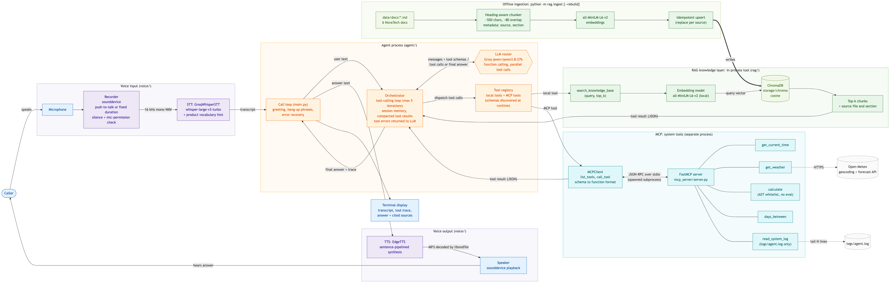

# NovaTech Voice Agent: Voice-Activated AI Support Agent (RAG + MCP)

A simulated phone-support agent for a fictional company, **NovaTech**. You speak a question,
it is transcribed, and an LLM decides **per question** whether to search the company knowledge
base (**RAG**), call live system tools on a separate **MCP server**, or both. The agent runs
the tool-calling loop until it has an answer, then **speaks** the answer and prints it with
a tool trace and cited sources.

```
You: I bought my X200 on 1st March 2026. Based on today's date, is it still under the standard warranty?
[ROUTER] iteration 1: LLM chose tool(s): get_current_time, search_knowledge_base
[MCP]    calling get_current_time({'timezone': 'Asia/Kolkata'})
[RAG]    'NovaBand X200 standard warranty period' -> warranty_policy.md§Standard Warranty Periods (0.805), ...
[ROUTER] iteration 2: LLM chose tool(s): days_between
[MCP]    calling days_between({'start_date': '2026-03-01', 'end_date': '2026-10-25'})
[ROUTER] final answer after 3 LLM call(s)
Nova: Yes, it's still covered. Your X200 has a 12-month, or 365-day, standard warranty, and it's
      been 238 days since you bought it, so you have about 127 days left.
Sources: warranty_policy.md § Standard Warranty Periods
```

## Demo

> 📹 _Demo video / GIF goes here_ (e.g. `docs/demo.gif`)
>
> 🖼️ _Screenshot of a call in the terminal goes here_ (e.g. `docs/screenshot.png`)

## Contents

- [Features](#features)
- [High-level design](#high-level-design)
- [Architecture](#architecture)
- [Design decisions and trade-offs](#design-decisions-and-trade-offs)
- [Setup](#setup) ([macOS / Linux](#macos--linux) · [Windows](#windows))
- [Running](#running)
- [Environment variables](#environment-variables)
- [Example queries](#example-queries)
- [Tests](#tests)
- [Project structure](#project-structure)
- [Troubleshooting](#troubleshooting)
- [Future improvements](#future-improvements)

## Features

- 🎙️ **Voice call loop**: spoken greeting, push-to-talk (Enter to start and stop) or
  fixed-duration recording, hang up by saying *"goodbye"* or *"end call"*.
- 🧠 **The LLM does the routing**: every turn the model sees all tools and picks RAG, MCP,
  both or neither. Independent calls run **in parallel** (e.g. knowledge base + clock).
- 📚 **RAG as a tool**: `search_knowledge_base(query, top_k)` over 6 NovaTech documents
  (local MiniLM embeddings + ChromaDB). Retrieval happens only when the LLM asks for it.
- 🔌 **MCP server** (FastMCP, stdio) with `get_current_time`, `get_weather` (Open-Meteo),
  a safe `calculate`, `days_between` and `read_system_log`. Tool schemas are
  **discovered at runtime** and converted to function-calling format; none are duplicated by hand.
- 🛡️ **Robust loop**: max 5 tool iterations then a forced answer, tool errors are fed back to
  the LLM instead of crashing, history is rolled back on API failure, a friendly message on rate limits.
- 🗣️ **Voice-first answers**: 2–4 spoken sentences; sources are cited **on screen**, never read aloud.
- ✅ **90 offline tests** (fake LLM, fake embedder, mocked HTTP, real stdio MCP round-trip).

## High-level design

> Source: [`docs/hld.mmd`](docs/hld.mmd) · Exported image: [`docs/hld.png`](docs/hld.png)

```mermaid
flowchart LR
    classDef io fill:#e3f2fd,stroke:#1565c0,color:#0d47a1
    classDef voice fill:#ede7f6,stroke:#5e35b1,color:#311b92
    classDef brain fill:#fff3e0,stroke:#ef6c00,color:#e65100
    classDef rag fill:#e8f5e9,stroke:#2e7d32,color:#1b5e20
    classDef mcp fill:#e0f7fa,stroke:#00838f,color:#006064
    classDef ext fill:#fafafa,stroke:#757575,color:#424242,stroke-dasharray:4 3
    classDef store fill:#f1f8e9,stroke:#558b2f,color:#33691e

    USER(["Caller"]):::io

    subgraph VOICE_IN["Voice input (voice/)"]
        direction TB
        MIC["Microphone"]:::io
        REC["Recorder<br/>sounddevice<br/>push-to-talk or fixed duration<br/>silence + mic-permission check"]:::voice
        STT["STT: GroqWhisperSTT<br/>whisper-large-v3-turbo<br/>+ product vocabulary hint"]:::voice
        MIC --> REC -->|"16 kHz mono WAV"| STT
    end

    subgraph AGENT["Agent process (agent/)"]
        direction TB
        LOOP["Call loop (main.py)<br/>greeting, hang-up phrases,<br/>error recovery"]:::brain
        ORCH["Orchestrator<br/>tool-calling loop (max 5 iterations)<br/>session memory, compacted tool results<br/>tool errors returned to LLM"]:::brain
        LLM{{"LLM router<br/>Groq qwen/qwen3.8-27b<br/>function calling, parallel tool calls"}}:::brain
        REG["Tool registry<br/>local tools + MCP tools<br/>(schemas discovered at runtime)"]:::brain
        LOOP -->|"user text"| ORCH
        ORCH <-->|"messages + tool schemas /<br/>tool calls or final answer"| LLM
        ORCH -->|"dispatch tool calls"| REG
    end

    subgraph RAG["RAG knowledge layer: in-process tool (rag/)"]
        direction TB
        KBT["search_knowledge_base<br/>(query, top_k)"]:::rag
        EMB["Embedding model<br/>all-MiniLM-L6-v2 (local)"]:::rag
        CHROMA[("ChromaDB<br/>storage/chroma<br/>cosine")]:::store
        CHUNKS["Top-k chunks<br/>+ source file and section"]:::rag
        KBT --> EMB -->|"query vector"| CHROMA --> CHUNKS
    end

    subgraph MCPSYS["MCP: system tools (separate process)"]
        direction TB
        MCPC["MCPClient<br/>list_tools, call_tool<br/>schema to function format"]:::mcp
        MCPS["FastMCP server<br/>mcp_server/server.py"]:::mcp
        T1["get_current_time"]:::mcp
        T2["get_weather"]:::mcp
        T3["calculate<br/>(AST whitelist, no eval)"]:::mcp
        T4["days_between"]:::mcp
        T5["read_system_log<br/>(logs/agent.log only)"]:::mcp
        MCPC <-->|"JSON-RPC over stdio<br/>(spawned subprocess)"| MCPS
        MCPS --- T1 & T2 & T3 & T4 & T5
    end

    METEO[("Open-Meteo<br/>geocoding + forecast API")]:::ext
    LOGF[("logs/agent.log")]:::ext

    subgraph VOICE_OUT["Voice output (voice/)"]
        direction TB
        TTS["TTS: EdgeTTS<br/>sentence-pipelined synthesis"]:::voice
        SPK["Speaker<br/>sounddevice playback"]:::io
        TTS -->|"MP3 decoded by libsndfile"| SPK
    end

    SCREEN["Terminal display<br/>transcript, tool trace,<br/>answer + cited sources"]:::io

    subgraph INGEST["Offline ingestion: python -m rag.ingest [--rebuild]"]
        direction LR
        DOCS["data/docs/*.md<br/>6 NovaTech docs"]:::store
        CHUNKER["Heading-aware chunker<br/>~550 chars, ~80 overlap<br/>metadata: source, section"]:::rag
        EMB2["all-MiniLM-L6-v2<br/>embeddings"]:::rag
        UPSERT["Idempotent upsert<br/>(replace per source)"]:::rag
        DOCS --> CHUNKER --> EMB2 --> UPSERT
    end

    USER -->|"speaks"| MIC
    STT -->|"transcript"| LOOP
    REG -->|"local tool"| KBT
    CHUNKS -->|"tool result (JSON)"| ORCH
    REG -->|"MCP tool"| MCPC
    MCPC -->|"tool result (JSON)"| ORCH
    T2 -.->|"HTTPS"| METEO
    T5 -.->|"tail N lines"| LOGF
    ORCH -->|"final answer + trace"| LOOP
    LOOP -->|"answer text"| TTS
    LOOP --> SCREEN
    SPK -->|"hears answer"| USER
    UPSERT ==>|"writes"| CHROMA

    style VOICE_IN fill:#f8f7fc,stroke:#b39ddb
    style VOICE_OUT fill:#f8f7fc,stroke:#b39ddb
    style AGENT fill:#fffaf3,stroke:#ffb74d
    style RAG fill:#f6fbf6,stroke:#81c784
    style MCPSYS fill:#f3fbfc,stroke:#4dd0e1
    style INGEST fill:#f9fbf5,stroke:#aed581
```





## Architecture

### Components

| Layer | Module | Responsibility |
|---|---|---|
| Entry / call loop | `main.py` | Wires components, runs the call: listen → think → show → speak. Greeting, hang-up detection, recovers from STT/LLM errors so the call never dies. |
| Display | `display.py` | Rich rendering of transcripts, the tool-call table, answers and cited sources. |
| Config | `config.py` | One immutable `Settings` from `.env`, paths, logging (coloured console + `logs/agent.log`). |
| Orchestrator | `agent/orchestrator.py` | The brain: tool-calling loop, tool registry (local + MCP), parallel execution, iteration cap, error-to-LLM, session memory and compaction, source collection. |
| LLM client | `agent/llm_client.py` | `LLMClient` protocol + `GroqLLMClient` (OpenAI-compatible tool calling). Normalises responses, strips leaked reasoning, retries malformed tool calls. |
| MCP client | `agent/mcp_client.py` | Spawns the MCP server over stdio, `list_tools` → OpenAI function schemas, `call_tool` → text or `MCPToolError`. |
| Prompts | `agent/prompts.py` | Compact system prompt (routing rules, grounding rules, spoken style), greeting, hang-up phrases. |
| RAG tool | `rag/tool.py` | `search_knowledge_base` schema + async handler returning JSON chunks with source and section. |
| Retriever | `rag/retriever.py` | Embeds the query, queries Chroma, returns scored chunks. |
| Ingestion | `rag/ingest.py` | Heading-aware chunking (~550 chars, ~80 overlap), embeddings, idempotent upsert, `--rebuild`. |
| Vector store | `rag/store.py` | Shared embedder and Chroma collection, so ingest and query can never disagree on model or metric. |
| MCP server | `mcp_server/server.py` | FastMCP server exposing the 5 system tools; logs to `logs/mcp_server.log` (stdout is the protocol). |
| Calculator | `mcp_server/calculator.py` | `ast`-whitelist evaluator: no `eval`, bounded exponent and result size. |
| Weather | `mcp_server/weather.py` | Open-Meteo geocoding + current conditions, WMO code mapping. |
| Recorder | `voice/recorder.py` | sounddevice capture (push-to-talk or fixed), silence and mic-permission detection, WAV encoding. |
| STT | `voice/stt.py` | `SpeechToText` protocol + Groq Whisper with a product-vocabulary hint. |
| TTS | `voice/tts.py` | `TextToSpeech` protocol + edge-tts with sentence-pipelined playback, `SilentTTS` for text mode. |

Every external dependency (LLM, STT, TTS, input source, tool server) sits behind a small
`Protocol`, so it can be swapped (for example OpenAI instead of Groq, or Whisper running
locally) without touching the orchestrator. The tests use exactly these seams: a scripted LLM
and a fake MCP server.

### Data flow of one turn

1. **Capture**: `Recorder` records 16 kHz mono audio until you press Enter. Silent clips are
   dropped, because Whisper invents text like "Thank you." on silence.
2. **Transcribe**: `GroqWhisperSTT` returns text; a vocabulary prompt keeps "NovaBand X200" spelled right.
3. **Route**: the `Orchestrator` sends history + **all tool schemas** (1 local + 5 MCP) to the LLM.
4. **Act**: for each requested tool call, local tools run in-process; MCP tools go over
   JSON-RPC/stdio to the server subprocess. Calls in the same step run concurrently.
   Failures become `{"error": ...}` results the LLM can reason about.
5. **Loop**: results are appended as `tool` messages and the LLM is called again, up to
   `MAX_TOOL_ITERATIONS` times, after which it must answer without tools.
6. **Respond**: the final text is printed with the tool table and cited sources, then spoken.
   TTS synthesizes sentence by sentence, so audio starts after about 1 s.
7. **Remember**: the turn stays in history, but its bulky tool results are replaced with a
   short placeholder (see below). History is capped at `MAX_HISTORY_TURNS`.

### Why RAG is a tool, not a pre-step

Always retrieving before the LLM call wastes latency and tokens on questions like "what's the
weather?" and pollutes the context with irrelevant chunks. As a tool, the LLM:

- decides **whether** to search (small talk and math don't),
- writes a **focused query** ("X200 standard warranty period") instead of embedding a rambling
  spoken sentence,
- can **search again** with a different query if the first results miss,
- can **combine** it with live data in the same step (warranty policy + today's date).

### Why the RAG tool is local but system tools are on MCP

- The **knowledge base is the agent's own domain layer**: it shares the agent's process, model
  cache and data, and calling it needs no network or serialization hop.
- **System tools are generic capabilities** (clock, weather, math, logs). Putting them behind
  MCP makes them reusable by any MCP client (desktop assistants, IDEs, other agents), lets them be
  developed and deployed independently, and isolates them in a separate process. A crash or
  hang in a tool can't take down the agent.
- The orchestrator treats both uniformly through one tool registry; the LLM can't tell
  the difference.

### Why MCP over stdio

The agent spawns the server as a subprocess and speaks JSON-RPC over stdin/stdout. Zero
network configuration, no ports or auth to manage, and the server's lifetime is tied to the
call. The trade-off is that one server serves one client on one machine; see trade-offs below.

### Conversation memory and compaction

Each LLM call resends the whole history. Keeping raw tool results (retrieved chunks, weather
JSON) would grow tokens quickly and tempt the model to reuse stale data ("today's date" from
an earlier turn). Dropping tool calls entirely was **tested and rejected**: with a history of
tool-free answers the model imitated it and answered from memory, inventing dates. The
compromise keeps the tool *calls* in history but replaces their *results* with a short
placeholder, so the model keeps the habit of calling tools while the context stays small.

## Design decisions and trade-offs

| Decision | Chosen | Alternatives | Why / trade-off |
|---|---|---|---|
| **LLM host** | Groq (`qwen/qwen3.8-27b`) | OpenAI, local Ollama | Groq's LPU inference returns tool calls in roughly 0.3–0.7 s, which matters for a voice call. Qwen supports **parallel tool calls** on Groq (gpt-oss does not), so RAG + MCP happens in one step. The brief asked for Llama, but Groq no longer serves Llama chat models to new keys (404), so Qwen is the tested default. Trade-off: the free tier allows 8K tokens/min (see Troubleshooting). |
| **Reasoning** | Model default (Qwen thinks briefly) | `reasoning_effort=none` | With thinking disabled, Qwen skipped tools and invented facts in testing. Reasoning text is stripped before display and speech. |
| **Embeddings** | Local `all-MiniLM-L6-v2` | OpenAI / Cohere embedding APIs | Free, offline after the first download, no second API key; a search (embed + Chroma query) takes tens of milliseconds on CPU. Trade-off: weaker on keyword-style queries than larger models (hybrid search or a reranker would help, see Future improvements). |
| **Vector DB** | ChromaDB (embedded, persistent) | Pinecone, Weaviate, pgvector | Zero infrastructure: a folder on disk, `pip install` only. Fine for thousands of chunks; a hosted DB would add replication, filtering at scale and multi-user access. |
| **Chunking** | Heading-aware, ~550 chars, ~80 overlap | Fixed-size tokens, semantic chunking | FAQ/policy docs are organised by heading, so chunks align with topics and carry `source` + `section` metadata for citations. The `title > section` prefix gives each embedding its context. |
| **STT** | Groq Whisper (`whisper-large-v3-turbo`) | Local faster-whisper, Deepgram | About 300 ms per utterance, same API key as the LLM, high accuracy. Trade-off: audio leaves the machine. |
| **TTS** | edge-tts | ElevenLabs, OpenAI TTS, pyttsx3 | Free, no key, natural neural voices, cross-platform. MP3 is decoded by the libsndfile bundled in `soundfile`, so **no ffmpeg**. Trade-off: unofficial service, network-dependent; failures fall back to on-screen text. |
| **Turn-taking** | Push-to-talk (+ `--duration` fallback) | VAD (Silero/WebRTC) with barge-in | Deterministic and robust in noisy rooms, trivial to demo, no false triggers from the agent's own voice. Trade-off: less natural than VAD; listed as a future improvement. |
| **MCP transport** | stdio | Streamable HTTP / SSE | No ports, auth or deployment, and lifecycle is tied to the agent. Trade-off: single client and local only. HTTP would allow a shared, remotely deployed tool server (and would then need auth). |
| **Audio I/O** | sounddevice | PyAudio | Ships PortAudio in wheels on Windows and macOS, so `pip install` just works. PyAudio often needs compilers on Windows. |
| **Calculator** | `ast` whitelist evaluator | `eval`, sympy, numexpr | No code execution possible by construction, tiny, no dependency. Bounds on exponent and result size prevent CPU or memory exhaustion (e.g. `9**9**9`). |

## Setup

**Prerequisites**

- **Python 3.11+** (developed and tested with 3.12 on macOS / Apple Silicon)
- A microphone and speakers/headphones for voice mode (text mode needs neither)
- A free **Groq API key**: https://console.groq.com/keys → *Create API Key*
- Internet access (Groq, edge-tts, Open-Meteo, and a one-time ~90 MB embedding model download)
- **ffmpeg is not required.**

### macOS / Linux

```bash
git clone <your-repo-url> voice-agent && cd voice-agent

# Linux only: PortAudio for sounddevice
# sudo apt-get install -y libportaudio2        (Debian/Ubuntu)
# sudo dnf install -y portaudio                (Fedora)

python3 -m venv .venv            # use python3.12 / python3.11 if python3 is older
source .venv/bin/activate
python -m pip install --upgrade pip
pip install -r requirements.txt

cp .env.example .env             # then edit .env and set GROQ_API_KEY=gsk_...

python -m rag.ingest             # build the knowledge base (first run downloads the model)
python main.py --text            # quick check without a microphone
python main.py                   # voice call
```

### Windows

PowerShell:

```powershell
git clone <your-repo-url> voice-agent; cd voice-agent

py -3.12 -m venv .venv           # or: py -3.11 -m venv .venv
.\.venv\Scripts\Activate.ps1     # if blocked: Set-ExecutionPolicy -Scope CurrentUser RemoteSigned
python -m pip install --upgrade pip
pip install -r requirements.txt

Copy-Item .env.example .env      # then edit .env and set GROQ_API_KEY=gsk_...

python -m rag.ingest
python main.py --text
python main.py
```

(Command Prompt: activate with `.venv\Scripts\activate.bat` and copy with `copy .env.example .env`.)

Windows has no system timezone database; the pinned `tzdata` package provides it for `get_current_time`.

## Running

| Command | What it does |
|---|---|
| `python main.py` | Voice call, push-to-talk: press **Enter** to start talking and **Enter** to stop. |
| `python main.py --duration 6` | Voice call with fixed 6-second recordings (hands-free). |
| `python main.py --text` | Type instead of speaking (debugging). Add `--tts` to also hear the answers. |
| `python main.py --list-devices` | List audio input/output devices. |
| `python -m rag.ingest [--rebuild]` | (Re)build the knowledge base. Re-running is idempotent; `--rebuild` drops and recreates it. |
| `python -m mcp_server.server` | Run the MCP server on its own (e.g. with `npx @modelcontextprotocol/inspector`). |

Say **"goodbye"**, **"end call"** or **"hang up"** to end the call, or press Ctrl+C.
Piped input works too: `printf "What's your return window?\ngoodbye\n" | python main.py --text`.

## Environment variables

Set these in `.env` (copied from `.env.example`). Only the API key is required.

| Name | Required | Default | Description |
|---|---|---|---|
| `GROQ_API_KEY` | **yes** | – | Groq API key, used for both the LLM and Whisper STT. |
| `GROQ_MODEL` | no | `qwen/qwen3.8-27b` | Groq chat model with tool calling (`openai/gpt-oss-120b` also works). |
| `GROQ_REASONING_EFFORT` | no | *(empty)* | Passed to reasoning models. Empty = model default. Use `low` for gpt-oss. Avoid `none` with Qwen. |
| `GROQ_STT_MODEL` | no | `whisper-large-v3-turbo` | Groq Whisper model (`whisper-large-v3` for slightly higher accuracy). |
| `TTS_VOICE` | no | `en-US-AriaNeural` | Any edge-tts voice (`edge-tts --list-voices`), e.g. `en-IN-NeerjaNeural`. |
| `EMBEDDING_MODEL` | no | `all-MiniLM-L6-v2` | sentence-transformers model. Re-run `python -m rag.ingest --rebuild` after changing. |
| `MAX_TOOL_ITERATIONS` | no | `5` | Max LLM↔tool round-trips per turn before forcing an answer. |
| `MAX_HISTORY_TURNS` | no | `8` | Conversation turns kept in memory. |
| `RAG_TOP_K` | no | `4` | Default number of chunks returned by `search_knowledge_base`. |
| `RECORD_SAMPLE_RATE` | no | `16000` | Microphone sample rate in Hz. |
| `LOG_LEVEL` | no | `INFO` | `DEBUG` also shows per-call token usage. |

## Example queries

Facts come from the mock docs in [`data/docs/`](data/docs), so answers can be checked.

| Type | Query | Expected tools → answer |
|---|---|---|
| RAG | "What's the battery life of the NovaBand X200 and is it waterproof?" | `search_knowledge_base` → up to 14 days; 5 ATM water resistant (swim-proof), not fully waterproof |
| RAG | "How much does the NovaHub cost in India?" | `search_knowledge_base` → ₹12,499 |
| RAG | "How do I factory reset the X200 if the screen is frozen?" | `search_knowledge_base` → hold the side button 15 s on the charger |
| MCP | "What's the weather in Mumbai right now?" | `get_weather` → live temperature and conditions |
| MCP | "What is the square root of 1764 times 3.5?" | `calculate` → 147 |
| MCP | "How many days are there between 15 August 2026 and Christmas?" | `days_between` → 132 |
| MCP | "Show me the last 5 lines of your system log." | `read_system_log` |
| **RAG + MCP** | "I bought my X200 on 1st March 2026. Based on today's date, is it still under the standard warranty?" | `search_knowledge_base` + `get_current_time` → `days_between` → yes, 238 of 365 days used |
| **RAG + MCP** | "What's your return window, and what's today's date?" | `search_knowledge_base` + `get_current_time` → 30 days from delivery; today's date |
| **RAG + MCP** | "If I buy the X200 plus NovaCare+, what's the total in rupees?" | `search_knowledge_base` + `calculate` → ₹8,999 + ₹1,499 = ₹10,498 |
| Memory | "How much is the X200?" → "And the NovaHub?" | second turn resolves "the NovaHub" in context |
| Grounding | "Does the X200 have an ECG sensor?" | `search_knowledge_base` → no ECG; lists the sensors the spec sheet does include |

## Tests

```bash
python -m pytest -q                  # 90 tests, under 1 second, no network or API key needed
python -m pytest -q -m "not integration"   # skip the test that spawns the MCP server
```

| File | Covers |
|---|---|
| `tests/test_orchestrator.py` | Scripted fake LLM: RAG + MCP in one turn with results matched to call ids, tool failure fed back, unknown tools and bad JSON args, iteration cap → forced tool-less answer, rollback on LLM failure, history compaction and cap, tool-name clashes. |
| `tests/test_calculator.py` | Valid math, injection attempts (`__import__`, dunder escapes, lambdas, comprehensions, names), resource exhaustion (`9**9**9`, chained powers, `factorial(1000)`), math errors. |
| `tests/test_mcp_tools.py` | Each tool's logic, `read_system_log` path restriction, Open-Meteo via mocked HTTP, schema conversion, and a real stdio MCP round-trip. |
| `tests/test_rag.py` | Heading split, chunk size and overlap, metadata on all docs, retrieval on a temp Chroma with a deterministic embedder, empty-KB error, `--rebuild`, tool output. |
| `tests/test_helpers.py` | Reasoning stripping, argument parsing, hang-up phrases, TTS sentence splitting, silence and mic-permission detection. |

## Project structure

```
voice-agent/
├── main.py                  # CLI entry: modes, listeners, the call loop
├── config.py                # Settings from .env, paths, logging
├── display.py               # Rich terminal rendering
├── agent/
│   ├── orchestrator.py      # tool-calling loop, routing, memory
│   ├── llm_client.py        # LLMClient protocol + Groq implementation
│   ├── mcp_client.py        # stdio MCP client + schema conversion
│   └── prompts.py           # system prompt, greeting, hang-up phrases
├── rag/
│   ├── ingest.py            # chunk → embed → store (python -m rag.ingest)
│   ├── retriever.py         # semantic search over Chroma
│   ├── store.py             # shared embedder + Chroma collection
│   └── tool.py              # search_knowledge_base tool
├── mcp_server/
│   ├── server.py            # FastMCP server (5 tools)
│   ├── calculator.py        # safe AST evaluator
│   └── weather.py           # Open-Meteo client
├── voice/
│   ├── recorder.py          # sounddevice capture
│   ├── stt.py               # Groq Whisper
│   └── tts.py               # edge-tts + playback
├── data/docs/               # 6 NovaTech markdown documents
├── docs/hld.mmd, hld.png    # architecture diagram
├── tests/                   # pytest suite
├── logs/  storage/          # runtime output (gitignored)
├── .env.example  requirements.txt  pyproject.toml
```

## Troubleshooting

| Symptom | Fix |
|---|---|
| **"microphone returned pure digital silence"** or it never hears you (macOS) | System Settings → Privacy & Security → **Microphone** → enable your terminal app (Terminal, iTerm, VS Code), then **restart the terminal**. |
| Same on Windows | Settings → Privacy & security → Microphone → allow desktop apps. Check the right input with `python main.py --list-devices`. |
| "Sorry, I didn't catch that" every time | Speak closer or louder, or use `--duration 6`. Make sure the default input device is your mic (`--list-devices`). |
| No sound / `[TTS] could not speak` | Check the default output device (`--list-devices`) and volume. The answer is still printed. edge-tts needs internet. |
| `PortAudio library not found` (Linux) | `sudo apt-get install libportaudio2` |
| `[LLM] Groq LLM rate-limited or busy; retrying in 12s` | The free tier allows **8,000 tokens/min**, and one tool turn uses about 2–6K. The SDK waits and retries automatically. Pause between questions, or upgrade to Groq's Developer tier. |
| `model ... does not exist or you do not have access` | Groq changed its model list. Run `python -c "from groq import Groq; print([m.id for m in Groq().models.list().data])"` and set `GROQ_MODEL` to a tool-calling model. |
| "The knowledge base is empty" | Run `python -m rag.ingest`. |
| Slow first start | The embedding model (~90 MB) downloads once to `~/.cache/huggingface`. Later starts take a few seconds. |
| `GROQ_API_KEY is not set` | `cp .env.example .env` and add your key. |
| `ModuleNotFoundError` | Activate the venv and run commands from the project root (`python -m rag.ingest`, not `python rag/ingest.py`). |

## Future improvements

- **Streaming end to end**: stream LLM tokens into TTS sentence by sentence, and stream STT
  (Groq or Deepgram realtime), to cut perceived latency below 1 s.
- **VAD + barge-in**: Silero/WebRTC VAD for hands-free turn-taking, and stop TTS when the caller
  starts talking.
- **Telephony**: Twilio Media Streams or SIP so it can take real phone calls (μ-law 8 kHz audio,
  streaming WebSocket).
- **MCP over Streamable HTTP with auth**: deploy the tool server separately (OAuth or API keys,
  per-tool authorization, rate limits) and share it across agents.
- **Better retrieval**: hybrid BM25 + vector search, a cross-encoder reranker, query rewriting,
  and score thresholds to say "I don't know" earlier.
- **Retrieval and answer evaluation**: a golden Q&A set with recall@k / MRR for retrieval and
  LLM-as-judge or RAGAS for groundedness, run in CI.
- **Observability**: OpenTelemetry traces per turn (STT, LLM, tool, TTS latencies), token cost tracking.
- **Human handoff**: an `escalate_to_human` tool that creates a ticket with the transcript.
- **Multilingual**: Whisper language detection + matching TTS voice (e.g. Hindi).
